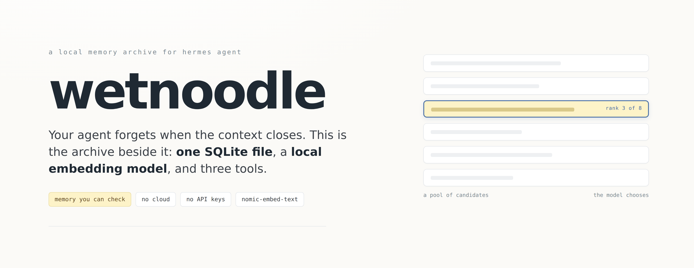
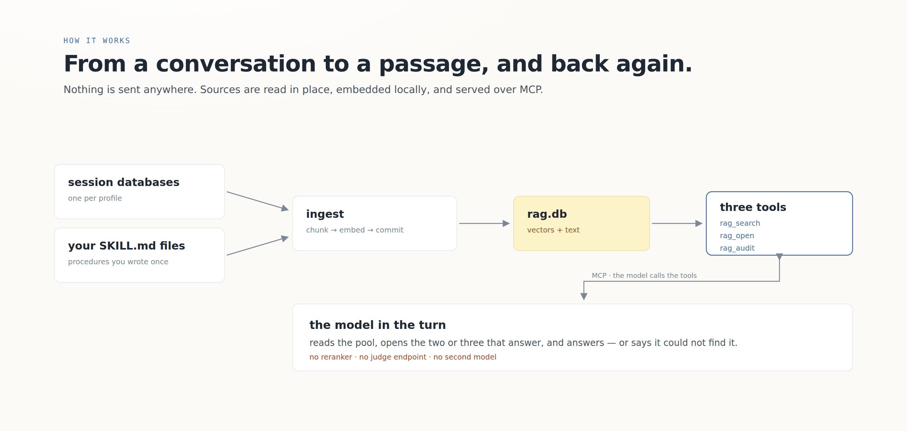

# wetnoodle

A local memory archive for [Hermes Agent](https://hermes-agent.nousresearch.com/docs). It indexes every
profile's session database — plus every `SKILL.md` you own — into one small vector store, so an agent can
answer *"what did we decide about X three weeks ago"* instead of only seeing what is still in its context
window. Everything stays on your machine: a SQLite file and a local Ollama embedding model. No API keys, no
cloud store, nothing to sign up for.



## What happens when you ask

Ingesting reads your session databases and skill files in place — nothing is copied out of them — splits the
text into passages, embeds each passage locally, and commits it to `rag.db` with a watermark, so the next run
picks up exactly where the last one stopped.

At question time the agent calls `rag_search`, which returns a **pool of candidates**: eight to a dozen
passages, each with a reference, a date, the corpus it came from, and the part of the passage where your
query's words actually appear. The agent reads the pool and calls `rag_open` on the two or three that answer
the question. `rag_audit` reports what is in the archive and how stale each corpus is.

## Start here

**Already running Hermes?** You still need step 1 (Ollama), then steps 2 and 4 — the registration script
attaches this archive to the agents you already have. Nothing else changes.

**You need all three.** Python 3.11+, a local Ollama daemon, and the `nomic-embed-text` model.

```bash
# 1. Ollama + the one required model (274 MB; the CPU is fine)
curl -fsSL https://ollama.com/install.sh | sh          # macOS/Windows: https://ollama.com/download
ollama pull nomic-embed-text
```

```bash
# 2. Clone, bootstrap, first index
git clone https://github.com/OleMurpho/wetnoodle.git && cd wetnoodle
./scripts/bootstrap.sh
```

`bootstrap.sh` builds a venv, installs two libraries, checks Ollama, runs `doctor.py`, then indexes
everything it can see. It needs no root and is safe to re-run. Indexing runs at about 16 passages a second
here, so a few thousand messages take a couple of minutes. You should end with a line like
`committed N chunk(s) across 4 corpora`.

```bash
# 3. Prove it works — ask for something you know is in your history
./.venv/bin/python query.py "the hostname of the machine that runs the bot"
```

A good result names the passage, its date, its profile and its score. If it says *no hits*, the index is
empty — run `python doctor.py`, which names the exact fix.

```bash
# 4. Let an existing Hermes agent use it
./scripts/register-mcp.sh          # every profile it can find
./scripts/register-mcp.sh work     # or only the ones you name
```

It writes a `bin/rag-mcp` wrapper — which strips inherited `PYTHON*`, so the agent's own interpreter cannot
leak its site-packages into this venv — then registers `mcp_servers.wetnoodle` on each profile. No hand-editing
YAML, and re-running it is safe. Restart the gateway or start a new session, and three tools appear:
`rag_search`, `rag_open`, `rag_audit`.

```bash
# 5. Keep it current — every two hours, off the hour, silent unless it fails
17 */2 * * * /absolute/path/to/wetnoodle/cron/refresh-with-ollama.sh
```

`refresh-with-ollama.sh` is the one to schedule: it starts Ollama pinned to four cores at nice 19, runs the
refresh under the same limits, and stops the daemon afterwards. Set `WETNOODLE_CPUS` if four is wrong for
your machine. In Hermes you can schedule the same script with the `cronjob` tool instead of crontab.

**If something is wrong**, `./.venv/bin/python doctor.py` preflights every dependency and prints the fix —
including whether this machine is the thread-rich, memory-poor shape that saturates (it will tell you if you
are inside WSL, and whether anything is capping core count). Less common problems are in
[`docs/troubleshooting.md`](docs/troubleshooting.md).

## How a search works

**The model that retrieves is the model that judges.** There is no reranker and no judge endpoint anywhere —
not local, not cloud. Vectors propose a neighbourhood; near-misses are chosen between by the model that asked,
which is the one thing in the stack already loaded, already holding the conversation, and already paid for.
That is why **answer quality follows the model you point at it**: a strong model reads the pool and picks, a
weak one takes the first hit. The tool tells it not to.

When a fact is corrected, the correction does not compete with the claim it replaces. Chunks carry a
nullable `superseded_by` and `superseded_at`, and `rag_search` filters retired passages out; a correction
optionally inherits the standing of the claim it retired, but only for queries that matched that claim
(`RAG_SUCCESSOR_BOOST`). Chunks also carry an `importance` score and its weighting knob
(`RAG_IMPORTANCE_WEIGHT`), off by default because no measurement yet justifies turning it on.

## How well it works

Forty-six questions about things that really happened here, each carrying a distinctive detail present in
exactly one passage. Nineteen were locked away while the system was built and never used for a decision.


**Six of nineteen** put the right passage first. The grey bar is the ceiling, not a result: in **seventeen of
nineteen**, the answer was already among the twenty candidates. Search succeeds at *finding* and fails at
*choosing* between near-misses, which is why `rag_search` hands a pool to the model instead of returning an
answer of its own. Exact method and numbers: [`docs/models.md`](docs/models.md).

## Commands

| Command | What it does |
|---|---|
| `python ingest.py` | incremental ingest of every session corpus |
| `python ingest.py --status` | per-corpus counts and watermarks |
| `python ingest.py --full` | rebuild available corpora from scratch |
| `python ingest.py --purge-missing` | drop corpora whose source database is gone |
| `python ingest_skills.py` | index every `SKILL.md` |
| `python query.py "text" [-k N] [--corpus C]` | search from the shell |
| `python eval_recall.py` | retrieval gate: where each known answer comes back |
| `python eval_recall.py --verify-markers` | is each eval marker actually present? |
| `python export_store.py --corpus X --out f.jsonl` | corpus → text (portable, diffable) |
| `python import_store.py f.jsonl --corpus peer` | text → corpus (re-embedded locally) |
| `python doctor.py` | preflight every dependency, and warn about machine shape |
| `./cron/refresh-with-ollama.sh` | pinned, low-priority refresh (the one to schedule) |
| `python -E -m unittest discover -s tests -q` | smoke test, no Ollama needed (`-E` ignores a stray `PYTHONPATH`) |

## Settings

Defaults are right for almost everyone. These relocate the store and bound the work; they are not an
invitation to experiment.

| Variable | Default | Effect |
|---|---|---|
| `RAG_DIR` | `~/.wetnoodle` | where `rag.db` lives |
| `RAG_HERMES_HOME` | `~/.hermes` | the Hermes install to index |
| `RAG_EMBED_MODEL` | `nomic-embed-text` | **pins vector dim**; changing it needs `ingest.py --full` |
| `RAG_OLLAMA` | `http://127.0.0.1:11434` | the local daemon |
| `RAG_SKILLS_DIRS` | discovered | override skill roots (`:`-separated) |
| `RAG_MAX_HIT_CHARS` | `800` | per-hit cap in tool output |
| `RAG_MAX_TOTAL_CHARS` | `6000` | cap across the whole result set |
| `RAG_NUM_THREADS` | `min(4, nproc)` | threads Ollama may use **per embedding request** |
| `RAG_BATCH` | `16` | passages per request; smaller means shorter load spikes |

The scoring knobs behind these (`RAG_HYBRID`, `RAG_VEC_WEIGHT`, per-corpus quotas, model prefixes) are
documented in [`docs/models.md`](docs/models.md) with the measurement that settled each.

## Prior art

The `importance` column and the supersede-with-successor pattern came from
[**mnemosyne-oss/mnemosyne**](https://github.com/mnemosyne-oss/mnemosyne) (MIT), which stores memories with
an importance score and retires a superseded fact instead of ranking it beside its replacement. Their
implementation is far broader; here it is two nullable columns and a filter. Successor forwarding is our
addition: on the case that motivated it, retiring the wrong answer alone left the correction at rank 6 of 8,
and with forwarding it is rank 1.

Marker-based recall scoring, bounded output, text export/rebuild and the job-runtime isolation pattern came
from [tomRumi/hermes-memory-rag](https://github.com/tomRumi/hermes-memory-rag) (MIT), which solves the
adjacent problem of curated project memory. No code was copied; the mechanisms were reimplemented against
this store and independently measured.

## Known limits

- **Paraphrase queries underperform identifier queries.** Embeddings drift from literal tokens; the keyword
  rerank only partly compensates.
- **Chunks are raw conversation.** Half a chunk can be boilerplate. Quality is bounded by what was said.
- **One embedding model per store.** Switching models without `--full` is a dimension mismatch, which reads
  like corruption — `import_store.py` refuses rather than write it.
- **Not multi-user.** It indexes the Hermes install it can see; there is no auth layer.

## Requirements and status

- **Hermes Agent with at least one profile, plus a local Ollama** running `nomic-embed-text` (768d). There is
  no cloud fallback and no second backend — Cloud Ollama cannot embed. Python 3.11+.
- **Ingesting is CPU-heavy.** One embedding request can saturate every core it can see. `RAG_NUM_THREADS`
  defaults to `min(4, nproc)`, and `cron/refresh-with-ollama.sh` pins the embedder to four cores at nice 19
  and stops the daemon afterwards. Keep the first index supervised.
- **A personal project, not a product.** No warranty, no support contract. It has broken a host once: a
  scheduled ingest pinned all 20 threads of a laptop, the WSL VM grew until Windows stopped responding, and
  the agent gateway on it crashed. Nothing was lost, and that incident is why the thread cap exists.

## Licence

MIT — see [LICENSE](LICENSE). Use it, fork it, ship it.
