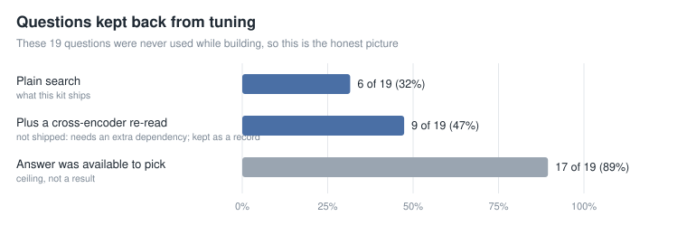
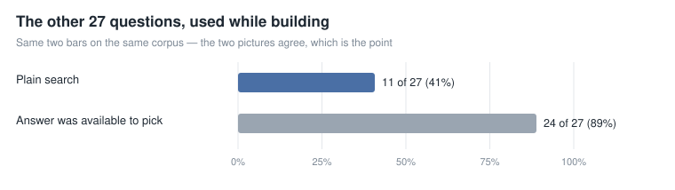
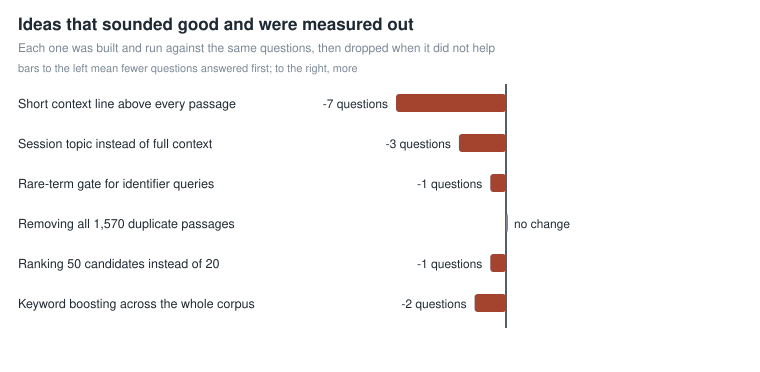

# wetnoodle

A local memory archive for [Hermes Agent](https://hermes-agent.nousresearch.com/docs). It indexes every
profile's session database — plus every `SKILL.md` you own — into one small vector store, so an agent can
answer *"what did we decide about X three weeks ago"* instead of only seeing what is still in its context
window. Everything stays on your machine: a SQLite file and a local Ollama embedding model. No API keys, no
cloud store, nothing to sign up for.

```
you ──▶ Hermes sessions (per profile, per SQLite db) ──┐
                                                       ├─▶ wetnoodle ingest ──▶ rag.db (vectors + text)
you ──▶ skills (*/SKILL.md) ───────────────────────────┘                              │
                                                                                      ▼
                                             agent (MCP tool) / query.py ◀── search ───┘
```

## Start here

**You need all three.** Python 3.11+, a local Ollama daemon, and the `nomic-embed-text` model.

```bash
# 1. Ollama + the one required model (274 MB; the CPU is fine)
curl -fsSL https://ollama.com/install.sh | sh          # macOS/Windows: https://ollama.com/download
ollama pull nomic-embed-text
```

```bash
# 2. Clone, bootstrap, first index
git clone https://github.com/OleMurpho/wetnoodle.git && cd wetnoodle
./scripts/bootstrap.sh
```

`bootstrap.sh` builds a venv, installs two libraries, checks Ollama, runs `doctor.py`, then indexes
everything it can see. It needs no root and is safe to re-run. Indexing runs at about 16 passages a second
here, so a few thousand messages take a couple of minutes — seven minutes for 7,000 passages on a
four-year-old graphics card, several times slower on the CPU alone. You should end with a line like
`committed N chunk(s) across 4 corpora`.

```bash
# 3. Prove it works — ask for something you know is in your history
./.venv/bin/python query.py "the hostname of the machine that runs the bot"
```

A good result names the passage, its date, its profile and its score. If it says *no hits*, the index is
empty — run `python doctor.py`, which names the exact fix.

```yaml
# 4. Let the agent use it — this goes in Hermes config.yaml (YAML, no braces)
mcp_servers:
  wetnoodle:
    command: /absolute/path/to/wetnoodle/.venv/bin/python
    args: [/absolute/path/to/wetnoodle/mcp_server.py]
```

Use the **absolute** interpreter path; a system `python` has no `numpy` or `mcp`. Restart the gateway (or
start a new session) and three tools appear: `rag_search`, `rag_open`, `rag_audit`.

```bash
# 5. Keep it current — every 30 minutes, silent unless it fails
*/30 * * * * /absolute/path/to/wetnoodle/cron/rag-refresh.sh
```

In Hermes you can schedule the same script with the `cronjob` tool instead of crontab.

**If something is wrong**, `./.venv/bin/python doctor.py` preflights every dependency and prints the fix.
Less common problems are in [`docs/troubleshooting.md`](docs/troubleshooting.md).

## How a search actually works

**The model that retrieves is the model that judges.** There is no reranker and no judge endpoint anywhere —
not local, not cloud.

1. `rag_search` returns a **pool of candidates**: a dozen passages, each with a ref, a date, a corpus, and the
   part of the passage where your query's words actually appear.
2. The agent reads them and calls `rag_open` on the ones that answer the question.
3. The agent answers from those passages — or says it could not find it.

Vectors propose a neighbourhood; near-misses are chosen between by the model that asked, which is the one
thing in the stack already loaded, already holding the conversation, and already paid for. That is why
**answer quality follows the model you point at it**: a strong model reads the pool and picks, a weak one
takes the first hit. The tool tells it not to.

## What it actually finds

We wrote 46 questions about things that really happened here, each carrying a distinctive detail — a command,
a hostname, a number — present in exactly one passage. Nineteen were locked away while the system was built
and never used for a decision. Every figure below is on a fixed 2,000-passage set, so changes compare like for
like.



**Six of nineteen** put the right passage first. The grey bar is not a result — it is the ceiling: in
**seventeen of nineteen**, the answer was already among the twenty candidates. Search fails at *choosing*
between near-misses, not at *finding*. That gap is the design.



On the hardest questions — detail present in three passages or fewer — it is first **once in eight**, inside
the top three **twice in eight**. No amount of ranking polish fixes that stratum, which is why `rag_search`
returns candidates instead of an answer. Exact figures and method: [`docs/models.md`](docs/models.md).

## The demo, without installing anything

**→ https://olemurpho.github.io/wetnoodle/** — a real index of **5,677 PubMed abstracts**, searchable in the
browser, every hit a real paper with title, journal, year and PMID.

A browser cannot run an embedding model, and the page says so: **typed queries are keyword-only (BM25)**.
The two sections below the search box replay the embedding search this project actually ships, precomputed
locally with `nomic-embed-text` and quantised to 256 dimensions:

- **You are the judge.** Three questions where the source abstract *is* in the eight candidates returned, but
  is not first — it ranks **3rd, 4th and 7th** of 5,677. You pick; the page shows where the source really sat.
  That is the choice the tool hands to a model instead of making itself.
- **Where it fails.** Three questions where the source is **not in the top five at all** — it sits at **12th,
  30th and 100th**. Nothing is hidden; the page shows the miss and then reveals the abstract it wanted.

Six questions, each written by hand against an abstract chosen in advance. That is curation, and it means
these are illustrations of the two regimes — pool-or-nothing — not a score. The score is
[**six of nineteen**](#what-it-actually-finds) on a held-out set, with the answer inside the top twenty
seventeen times.

## Commands

| Command | What it does |
|---|---|
| `python ingest.py` | incremental ingest of every session corpus |
| `python ingest.py --status` | per-corpus counts and watermarks |
| `python ingest.py --full` | rebuild available corpora from scratch |
| `python ingest.py --purge-missing` | drop corpora whose source database is gone |
| `python ingest_skills.py` | index every `SKILL.md` |
| `python query.py "text" [-k N] [--corpus C]` | search from the shell |
| `python eval_recall.py` | retrieval gate: where each known answer comes back |
| `python eval_recall.py --verify-markers` | is each eval marker actually present? |
| `python export_store.py --corpus X --out f.jsonl` | corpus → text (portable, diffable) |
| `python import_store.py f.jsonl --corpus peer` | text → corpus (re-embedded locally) |
| `python doctor.py` | preflight every dependency |
| `python -E -m unittest discover -s tests -q` | smoke test, no Ollama needed (`-E` ignores a stray `PYTHONPATH`) |

## Settings

Defaults are right for almost everyone. These relocate the store; they are not an invitation to experiment.

| Variable | Default | Effect |
|---|---|---|
| `RAG_DIR` | `~/.wetnoodle` | where `rag.db` lives |
| `RAG_HERMES_HOME` | `~/.hermes` | the Hermes install to index |
| `RAG_EMBED_MODEL` | `nomic-embed-text` | **pins vector dim**; changing it needs `ingest.py --full` |
| `RAG_OLLAMA` | `http://127.0.0.1:11434` | the local daemon |
| `RAG_SKILLS_DIRS` | discovered | override skill roots (`:`-separated) |
| `RAG_MAX_HIT_CHARS` | `800` | per-hit cap in tool output |
| `RAG_MAX_TOTAL_CHARS` | `6000` | cap across the whole result set |

The scoring knobs behind these (`RAG_HYBRID`, `RAG_VEC_WEIGHT`, per-corpus quotas, model prefixes) are in
[`docs/models.md`](docs/models.md) with the measurement that settled each. Every one is measured worse or
neutral, so there is no reason to reach for them.

## What did not survive being measured

Every row was built, run against the same questions, and dropped:



- **A context line above every passage.** Published advice for exactly this problem, and it made things
  *worse* — seven fewer questions answered first. Boilerplate repeated thousands of times competes with the
  words that matter.
- **The session's opening topic instead of a context line.** Still three fewer.
- **A gate forcing rare identifier terms to match.** One fewer: the questions that need it are the ones where
  the identifier is the *answer*, so it is not in the query to gate on.
- **Removing all 1,570 duplicate passages** (20% of the archive). No change at all — duplicates were not
  stealing rank, just occupying slots nobody wanted.
- **Keyword boosting across the whole corpus.** Two fewer, because a word that appears everywhere outranks the
  words that appear once.

Two were abandoned unfinished, so they carry no number: **ranking fifty candidates** cost about three times
as much per search and had not cleared ten questions after forty-six minutes, and a **4B embedding model**
ran at 0.8 passages a second — nearly three hours an index — while the ceiling says a bigger embedder raises a
limit that was not the constraint.

## Known limits

- **Paraphrase queries underperform identifier queries.** Embeddings drift from literal tokens; the keyword
  rerank only partly compensates.
- **Chunks are raw conversation.** Half a chunk can be boilerplate. Quality is bounded by what was said.
- **One embedding model per store.** Switching models without `--full` is a dimension mismatch, which reads
  like corruption — `import_store.py` refuses rather than write it.
- **Not multi-user.** It indexes the Hermes install it can see; there is no auth layer.

## Other projects, and what we took from them

Marker-based recall scoring, bounded output, text export/rebuild and the job-runtime isolation pattern came
from [tomRumi/hermes-memory-rag](https://github.com/tomRumi/hermes-memory-rag) (MIT), which solves the adjacent
problem of curated project memory. No code was copied; the mechanisms were reimplemented against this store
and independently measured.

## Licence

MIT — see [LICENSE](LICENSE). Use it, fork it, ship it.
