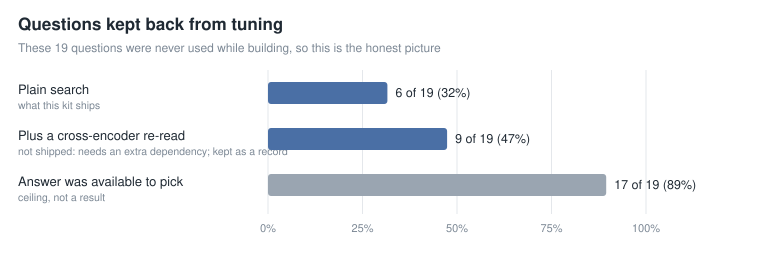

# wetnoodle

A local memory archive for [Hermes Agent](https://hermes-agent.nousresearch.com/docs). It indexes every
profile's session database — plus every `SKILL.md` you own — into one small vector store, so an agent can
answer *"what did we decide about X three weeks ago"* instead of only seeing what is still in its context
window. Everything stays on your machine: a SQLite file and a local Ollama embedding model. No API keys, no
cloud store, nothing to sign up for.


## What happens when you ask

Ingesting reads your session databases and skill files in place — nothing is copied out of them — splits the
text into passages, embeds each passage locally, and commits it to `rag.db` with a watermark, so the next run
picks up exactly where the last one stopped.

At question time the agent calls `rag_search`, which returns a **pool of candidates**: eight to a dozen
passages, each with a reference, a date, the corpus it came from, and the part of the passage where your
query's words actually appear. The agent reads the pool and calls `rag_open` on the two or three that answer
the question. `rag_audit` reports what is in the archive and how stale each corpus is.

## Start here

**Already running Hermes?** You still need step 1 (Ollama), then steps 2 and 4 — the registration script
attaches this archive to the agents you already have. Nothing else changes.

**You need all three.** Python 3.11+, a local Ollama daemon, and the `nomic-embed-text` model.

```bash
# 1. Ollama + the one required model (274 MB; the CPU is fine)
curl -fsSL https://ollama.com/install.sh | sh          # macOS/Windows: https://ollama.com/download
ollama pull nomic-embed-text
```

On any machine that already runs Hermes and a local Ollama, one command does the whole install —
bootstrap, MCP server, memory provider and the refresh watchdog:

```bash
git clone https://github.com/OleMurpho/wetnoodle.git && cd wetnoodle
./scripts/install.sh -p <profile> --scope-shared
```

It is idempotent, so it is also the repair command. The steps below are what it runs, in that order, if
you would rather do them one at a time or see what each one changed.

```bash
# 2. Clone, bootstrap, first index
git clone https://github.com/OleMurpho/wetnoodle.git && cd wetnoodle
./scripts/bootstrap.sh
```

`bootstrap.sh` builds a venv, installs two libraries, checks Ollama, runs `doctor.py`, then indexes
everything it can see. It needs no root and is safe to re-run. Indexing runs at about 16 passages a second
here, so a few thousand messages take a couple of minutes. You should end with a line like
`committed N chunk(s) across 4 corpora`.

```bash
# 3. Prove it works — ask for something you know is in your history
./.venv/bin/python -m wetnoodle.query "the hostname of the machine that runs the bot"
```

A good result names the passage, its date, its profile and its score. If it says *no hits*, the index is
empty — run `python -m wetnoodle.doctor`, which names the exact fix.

```bash
# 4. Let an existing Hermes agent use it
./scripts/register-mcp.sh          # every profile it can find
./scripts/register-mcp.sh work     # or only the ones you name
```

It writes a `bin/rag-mcp` wrapper — which strips inherited `PYTHON*`, so the agent's own interpreter cannot
leak its site-packages into this venv — then registers `mcp_servers.wetnoodle` on each profile. No hand-editing
YAML, and re-running it is safe. Restart the gateway or start a new session, and three tools appear:
`rag_search`, `rag_open`, `rag_audit`.

```bash
# 5. Keep it current — a Hermes cron job, every thirty minutes, silent unless it fails
./scripts/install-refresh-job.sh -p <profile>
```

That installs the watchdog where Hermes can find it and creates the job, or updates the one that is already
there, so running it twice is harmless. It reads the archive path out of that profile's configuration rather
than assuming one, which is what makes the same command correct on every host. The watchdog itself lives in
this checkout at `scripts/cron/rag_auto_ingest.sh`; the file it writes into the profile is a three-line shim
that pins this machine's paths and execs the checkout copy, so an edit to the watchdog reaches every machine
on its next pull instead of drifting per host.

The job prints nothing when the refresh succeeds. That silence is the design: a watchdog that reports every
half hour is a watchdog nobody reads. On failure it prints the error and the last lines of the refresh output.

If you are not using Hermes cron, schedule `scripts/cron/refresh-with-ollama.sh` from crontab instead. It
starts Ollama pinned to four cores at nice 19, runs the refresh under the same limits, and stops the daemon
afterwards; set `WETNOODLE_CPUS` if four is wrong for your machine. The two paths do the same work, so pick
one.

**If something is wrong**, `./.venv/bin/python -m wetnoodle.doctor` preflights every dependency and prints the fix —
including whether this machine is the thread-rich, memory-poor shape that saturates (it will tell you if you
are inside WSL, and whether anything is capping core count). Less common problems are in
[`docs/troubleshooting.md`](docs/troubleshooting.md).

## Repository layout

```
wetnoodle/        the package: rag_core and render, plus one module per command
plugin/           the optional Hermes memory provider (pre-turn recall)
scripts/          bootstrap, MCP registration, hygiene gate, chart rendering, sweeps
scripts/cron/     the refresh work and the watchdog that schedules it
tests/            smoke tests, no Ollama required
eval/             question sets for eval_recall.py
docs/             troubleshooting, model notes, roadmap, and the README images
```

Commands are modules, run from the repository root:

```bash
./.venv/bin/python -m wetnoodle.ingest --status
./.venv/bin/python -m wetnoodle.query "the hostname of the bot machine"
```

## Optional — make it the agent's memory

The MCP tools only work when the model decides to look. The memory provider does not wait to be asked:
before each turn it searches the archive with the user's own message and injects whatever clears a score
floor, and it adds a `memory_search` tool for the cases the injection misses.

```bash
./scripts/install-memory-provider.sh            # every profile it finds
./scripts/install-memory-provider.sh work       # or only the ones you name
./scripts/install-memory-provider.sh --remove   # unlink again
```

It symlinks `plugin/` into `<profile>/plugins/wetnoodle` rather than copying it, so the profile never becomes
a second, drifting copy of the code, and it sets the three keys the provider needs:

| Key | Value | Why |
|---|---|---|
| `memory.provider` | `wetnoodle` | selects this provider |
| `memory.wetnoodle.repo` | the checkout | where `wetnoodle/rag_core.py` lives |
| `memory.wetnoodle.db_dir` | the store | which archive is read — it defaults to `~/.wetnoodle`, which is not always the one the MCP tools serve |

### Every profile shares one store

On a machine running several agents, each profile's transcripts are ingested into the same archive under
its own corpus name, and by default every profile can read all of them: pre-turn recall for one agent will
happily surface another's private conversation. Both halves of the integration take a scope:

```bash
./scripts/register-mcp.sh --scope-shared             # read everything except other profiles
./scripts/install-memory-provider.sh --scope-shared
./scripts/register-mcp.sh --scope                    # strict: own corpus, skill, notes only
```

`--scope-shared` is the one most installs want: skills, imported manuals and notes stay
reachable, and the only thing hidden is the transcripts of the other agents. It leaves the
base install's `default` corpus visible, because that is usually the longest history on the
machine; `--scope` is the strict form when you do want it closed.

The scope is enforced inside search and inside `rag_open`, not by filtering results afterwards, so `k`
is spent on chunks the caller is allowed to see. A ref from outside the scope is reported as missing
rather than refused, because "it exists but you may not read it" is itself a disclosure.

Injection is gated: a passage is only injected when it clears `score_floor` (0.62 by default) and, if set, a
margin over the next candidate, so most turns add nothing. Writes still go through the core memory tool and
are mirrored into the archive, so `MEMORY.md` stays readable on disk. With `serve_memory` off it is yours to
edit freely. With `serve_memory` on it is generated on every refresh, and hand-written text must sit below
the `<!-- hand-edited below this line -->` marker in `MEMORY.long.md` or the next refresh discards it —
that text is kept verbatim and counted against the same budget as the rest of the long-term section.
Restart the gateway after installing; `hermes -p <profile> memory status` says whether it loaded.

## How a search works

**The model that retrieves is the model that judges.** There is no reranker and no judge endpoint anywhere —
not local, not cloud. Vectors propose a neighbourhood; near-misses are chosen between by the model that asked,
which is the one thing in the stack already loaded, already holding the conversation, and already paid for.
That is why **answer quality follows the model you point at it**: a strong model reads the pool and picks, a
weak one takes the first hit. The tool tells it not to.

When a fact is corrected, the correction does not compete with the claim it replaces. Chunks carry a
nullable `superseded_by` and `superseded_at`, and `rag_search` filters retired passages out; a correction
optionally inherits the standing of the claim it retired, but only for queries that matched that claim
(`RAG_SUCCESSOR_BOOST`). Chunks also carry an `importance` score and its weighting knob
(`RAG_IMPORTANCE_WEIGHT`), off by default because no measurement yet justifies turning it on.

## How well it works

Forty-six questions about things that really happened here, each carrying a distinctive detail present in
exactly one passage. Nineteen were locked away while the system was built and never used for a decision.



On the fixed **2,000-passage comparison set** behind that chart — the set every setting in this project was
measured against — **six of nineteen** put the right passage first, and in **seventeen of nineteen** the answer
was already among the twenty candidates. On a full 7,674-passage archive the same shipped default was first
**nine of nineteen** times and had the answer available **sixteen of nineteen**. That is a three-question
difference on nineteen questions — treat it as noise, not as evidence that a bigger archive helps.

Those are different corpora, and quoting one as if it were the other is how a benchmark stops meaning
anything. Search succeeds at *finding* and fails at *choosing* between near-misses, which is why `rag_search`
hands a pool to the model instead of returning an answer of its own. Exact method and both sets:
[`docs/models.md`](docs/models.md).

## Commands

| Command | What it does |
|---|---|
| `python -m wetnoodle.ingest` | incremental ingest of every session corpus |
| `python -m wetnoodle.ingest --status` | per-corpus counts and watermarks |
| `python -m wetnoodle.ingest --full` | rebuild available corpora from scratch |
| `python -m wetnoodle.ingest --reembed` | re-embed every chunk and memory item after a model switch |
| `python -m wetnoodle.ingest --purge-missing` | drop corpora whose source database is gone |
| `python -m wetnoodle.retire c1234 --by c1250` | retire a chunk, naming the one that replaces it |
| `python -m wetnoodle.ingest_skills` | index every `SKILL.md` |
| `python -m wetnoodle.query "text" [-k N] [--corpus C]` | search from the shell |
| `./scripts/install-refresh-job.sh -p <profile>` | install or update the refresh watchdog as a Hermes cron job |
| `python -m wetnoodle.eval_recall` | retrieval gate: where each known answer comes back |
| `python -m wetnoodle.eval_recall --verify-markers` | is each eval marker actually present? |
| `python -m wetnoodle.export_store --corpus X --out f.jsonl` | corpus → text (portable, diffable) |
| `python -m wetnoodle.import_store f.jsonl --corpus peer` | text → corpus (re-embedded locally) |
| `python -m wetnoodle.doctor` | preflight every dependency, and warn about machine shape |
| `./scripts/cron/refresh-with-ollama.sh` | pinned, low-priority refresh (the crontab alternative) |
| `python -E -m unittest discover -s tests -q` | smoke test, no Ollama needed (`-E` ignores a stray `PYTHONPATH`) |

## Settings

Defaults are right for almost everyone. These relocate the store and bound the work; they are not an
invitation to experiment.

| Variable | Default | Effect |
|---|---|---|
| `RAG_DIR` | `~/.wetnoodle` | where `rag.db` lives |
| `RAG_HERMES_HOME` | `~/.hermes` | the Hermes install to index |
| `RAG_EMBED_MODEL` | `nomic-embed-text` | **pins vector dim**; switching needs `--reembed`, not `--full` |
| `RAG_OLLAMA` | `http://127.0.0.1:11434` | the local daemon |
| `RAG_SKILLS_DIRS` | discovered | override skill roots (`:`-separated) |
| `RAG_MAX_HIT_CHARS` | `800` | per-hit cap in tool output |
| `RAG_MAX_OPEN_CHARS` | `1500` | per-passage cap for `rag_open`, large enough for a whole chunk |
| `RAG_ALLOWED_CORPORA` | unset | allowlist; unset means every corpus is visible |
| `RAG_EXCLUDED_CORPORA` | unset | denylist; wins over the allowlist, and is how `--scope-shared` works |
| `RAG_MAX_TOTAL_CHARS` | `6000` | cap across the whole result set |
| `RAG_NUM_THREADS` | `min(4, nproc)` | threads Ollama may use **per embedding request** |
| `RAG_BATCH` | `16` | passages per request; smaller means shorter load spikes |

The scoring knobs behind these (`RAG_HYBRID`, `RAG_VEC_WEIGHT`, per-corpus quotas, model prefixes) are
documented in [`docs/models.md`](docs/models.md) with the measurement that settled each.

## Prior art

The `importance` column and the supersede-with-successor pattern came from
[**mnemosyne-oss/mnemosyne**](https://github.com/mnemosyne-oss/mnemosyne) (MIT), which stores memories with
an importance score and retires a superseded fact instead of ranking it beside its replacement. Their
implementation is far broader; here it is two nullable columns and a filter. Successor forwarding is our
addition: on the case that motivated it, retiring the wrong answer alone left the correction at rank 6 of 8,
and with forwarding it is rank 1.

Marker-based recall scoring, bounded output, text export/rebuild and the job-runtime isolation pattern came
from [tomRumi/hermes-memory-rag](https://github.com/tomRumi/hermes-memory-rag) (MIT), which solves the
adjacent problem of curated project memory. No code was copied; the mechanisms were reimplemented against
this store and independently measured.

## Known limits

- **Paraphrase queries underperform identifier queries.** Embeddings drift from literal tokens; the keyword
  rerank only partly compensates.
- **Chunks are raw conversation.** Half a chunk can be boilerplate. Quality is bounded by what was said.
- **When `serve_memory` is on, `MEMORY.md` is generated.** Hand-written lines go below the
  `<!-- hand-edited below this line -->` marker in `MEMORY.long.md` and are kept verbatim on every refresh; text
  above the marker is rewritten from the store. Without `serve_memory` the file is yours to edit freely. A switch is refused before it can mix dimensions; `--reembed` rewrites
  every chunk and memory item in place, including frozen and imported corpora that `--full` skips.
- **Retirements survive a rebuild, by content coordinates.** Supersession is stored against chunk ids, which a
  `--full` rebuild replaces, so the commit snapshots retirements by (corpus, session, msg_start, msg_end) and
  re-applies them to the new rows in the same transaction. It follows the successor to its new id; a successor
  that no longer exists yields the `-1` sentinel rather than a dead pointer.
- **The ingest lock is POSIX-only** (`fcntl`). Linux, WSL and macOS are fine; native Windows would fail at
  import rather than silently run unlocked.
- **Not multi-user.** It indexes the Hermes install it can see; there is no auth layer.

## Requirements and status

- **Hermes Agent with at least one profile, plus a local Ollama** running `nomic-embed-text` (768d). There is
  no cloud fallback and no second backend — Cloud Ollama cannot embed. Python 3.11+.
- **The interpreter that runs Hermes must be able to import `numpy`.** The MCP server uses wetnoodle's own
  venv, but the memory provider runs inside Hermes' interpreter — and Hermes' bundled runtime is often a
  minimal build without numpy. Without it the provider reports *not available* even though the archive and
  the checkout are fine. With a bundled runtime, install it there:
  `pip install --target <runtime>/lib/python3.X/site-packages numpy`.
- **Ingesting is CPU-heavy.** One embedding request can saturate every core it can see. `RAG_NUM_THREADS`
  defaults to `min(4, nproc)`, and `scripts/cron/refresh-with-ollama.sh` pins the embedder to four cores at nice 19
  and stops the daemon afterwards. Keep the first index supervised.
- **A personal project, not a product.** No warranty, no support contract. It has broken a host once: a
  scheduled ingest pinned all 20 threads of a laptop, the WSL VM grew until Windows stopped responding, and
  the agent gateway on it crashed. Nothing was lost, and that incident is why the thread cap exists.

## Licence

MIT — see [LICENSE](LICENSE). Use it, fork it, ship it.
